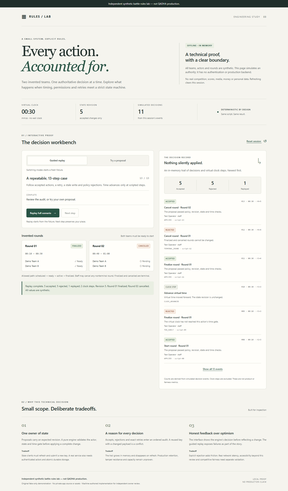

# QADHA — Product Case Study

QADHA is the flagship digital product developed under Saltrixma LLC. It brings vertical video, social interaction, messaging, live-format discovery, team participation and structured competition into one connected mobile experience, supported by an internal operations console.

> **Publication boundary:** public product case study **plus an original, independent synthetic Battle Rules Lab**. The lab is not QADHA application source and does not prove production behavior. Private application code, internal materials, credentials, databases and customer data remain private.

## Independent runnable engineering proof

The [Battle Rules Lab](demo/battle-rule-lab/README.md) implements an original fictional competition state engine with two invented teams, version-checked decisions, idempotent retries, time-gated transitions, simulated staff/participant policy and an in-memory audit. It is **not** a production QADHA app, real authentication, live competition, distributed lock, video service or payment system.

**QA record (21 November 2026):** 36/36 independently rerun Node tests and 60/60 Chrome desktop/mobile browser assertions passed; [GitHub Actions on the published main branch also passed](https://github.com/a7medgamil/qadha-platform-showcase/actions/runs/44896934520). Source, [local QA report](demo/battle-rule-lab/QA_REPORT.md), [engineering provenance](docs/INDEPENDENT-BATTLE-RULES-ENGINEERING.md) and [mobile screenshot](demo/battle-rule-lab/screenshots/mobile-390.png) are public.

*This simulation is deliberately offline with fictional records. Its tests cannot establish QADHA's production authorization, fairness, media delivery or availability.*

## Product model

QADHA is organised around five connected product objects:

- **Viewer and creator** — discover, watch and publish content.
- **Armies** — persistent teams with identity and ranks.
- **Battles** — structured competitive events with phases and rounds.
- **Wallet** — a test economy with separate social and battle-only items.
- **Operations console** — content, moderation, catalog and rules administration.

The product direction connects content, conversation and participation rather than treating them as separate destinations.

## Product experience

The documented app journey covers eight modules:

1. **Home** — stories, featured video, recommendations and trending content.
2. **Reels & videos** — vertical viewing, creator actions and related content.
3. **Create** — entry points for live formats, uploads, challenges and competitions.
4. **Live discovery** — categories, featured streams and a directory of formats; live video transport is not claimed.
5. **Armies** — persistent teams, search and rankings.
6. **Chats** — private conversations, groups and communities.
7. **Messages** — direct conversations with text, shared video and voice notes.
8. **Gifts & store** — catalogues for social gifts, appearances and battle-only items.

## Product and engineering decisions

- One React Native and Expo mobile codebase is documented for Android, iOS and web.
- The operations console is built with Next.js and uses role-based permissions.
- PostgreSQL is the documented relational data layer.
- Competition uses a server-authoritative model: clients send actions; the server owns validation and outcomes.
- Battle rules and tools are configurable; economy records are separated from battle state.
- Ledgers are append-only and sensitive operations are audited.
- Content migration is an internal, rights-gated workflow.

## Current product boundaries

| Area | Portfolio record |
|---|---|
| Mobile application | Android beta distributed; iOS release pending |
| Product website | `qadhaapp.com`, recorded reachable 14 Nov 2026 |
| Android build | 0.2.4 · build 17 · 10 Oct 2026 |
| Operations console | Internal; role-based access and audit records |
| Battle authority | Built; cinematic media layer simulated |
| Economy and ledgers | Test economy only; no real payments connected |
| Live video transport | Not claimed |
| App-store billing and creator payouts | Proposed |
| Public usage, revenue and growth metrics | Not available; no figures are claimed |

See [Product Map](docs/PRODUCT-MAP.md), [High-Level Architecture](docs/ARCHITECTURE.md) and [Evidence & Status](docs/STATUS.md).

**For remote Product / Technical PM roles:** [Product Decisions, Proposed Acceptance Criteria & Evidence Review](docs/PRODUCT-DECISIONS-AND-EVIDENCE.md). This is a recruiter-facing analysis that explicitly separates recorded product decisions from proposed tests and unverified metrics.

## Ownership and portfolio record

QADHA is developed under Saltrixma LLC. The application source remains in a separate private repository.

- [QADHA public product website](https://qadhaapp.com)
- [Saltrixma LLC portfolio record](https://ahmed-gamil-portfolio.ahmedabdulbarim.workers.dev/saltrixma)
- [Executive portfolio](https://ahmed-gamil-portfolio.ahmedabdulbarim.workers.dev)

No public launch, real-money economy, live video availability, user count, revenue or growth outcome is implied by this documentation.

© 2026 Saltrixma LLC. All rights reserved.
